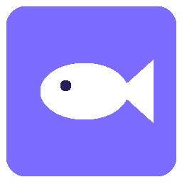

<div align="center">



# MojarraCut

**Editor de video para Windows en el que Claude edita contigo.**
Pídele un video en lenguaje natural y míralo armarse en la línea de tiempo.


[Características](#-características) · [Instalación](#-instalación) · [Claude](#-editar-con-claude) · [Desarrollo](#-desarrollo)

</div>

---

> *"Corta las pausas largas, pon subtítulos estilo karaoke y agrega música suave de fondo."*
>
> Escríbelo en el chat y Claude lo hace. Si algo no te gusta, **Ctrl+Z**.

## ✨ Características

<table>
<tr>
<td width="50%" valign="top">

### 🤖 Claude dentro de la app
- Chat integrado en el editor, junto a las demás ventanas
- Elige **modelo** (Fable, Opus, Sonnet, Haiku) y **esfuerzo**
- Adjunta **imágenes**: pégalas o arrástralas al chat
- Cada proyecto guarda **su propia conversación**
- Ves los cambios **al instante** y los deshaces con Ctrl+Z

</td>
<td width="50%" valign="top">

### 🎬 Edición completa
- Pistas de **video, imagen, audio y texto**
- **Transiciones**: disolver, negro, deslizar, empujar
- **Efectos**: blanco y negro, sepia, desenfoque, brillo, tono…
- Recorte, escala, posición, opacidad y fundidos
- Exporta a **MP4** (YouTube, Shorts/Reels/TikTok, cuadrado, 4K)

</td>
</tr>
<tr>
<td valign="top">

### 💬 Subtítulos que siguen la voz
- Transcribe **en tu PC** (Whisper, sin internet) o **en la nube** (Groq / OpenAI)
- Los modelos se descargan solo si los necesitas
- 9 diseños: *karaoke, impacto, neón, marcador, TV…*
- Animación **palabra por palabra**, sincronizada con lo que se dice

</td>
<td valign="top">

### 🧩 Pensado para trabajar cómodo
- Ventanas que se mueven, redimensionan y ocultan
- Selección con recuadro, copiar y pegar, menús contextuales
- Carpetas de medios con arrastrar y soltar
- Guardado automático e historial de deshacer
- Probado con las **10 heurísticas de Nielsen**

</td>
</tr>
</table>

## 📦 Instalación

1. Descarga el instalador `MojarraCut Setup x.y.z.exe` desde [**Releases**](https://github.com/MilioGa/MojarraCut/releases).
2. Ábrelo, elige la carpeta (opcional) y pulsa **Instalar**.
3. Tus proyectos se guardan en `Documentos\MojarraCut`.

> No necesita permisos de administrador. Al desinstalar, tus proyectos se conservan.

## 🤖 Editar con Claude

MojarraCut usa **[Claude Code](https://claude.com/download)**, que viene incluido en la app de escritorio de Claude (planes de pago). No hay que configurar claves.

| Forma | Cómo |
|---|---|
| **Chat integrado** | Abre un proyecto y pulsa **Claude** en la barra superior. |
| **Terminal** | En la pantalla de inicio, pulsa **Editar con Claude**. |
| **Tu propia sesión** | Abre Claude Code en `Documentos\MojarraCut`: el archivo `CLAUDE.md` le explica todo. |

**¿Por qué gasta poco?** Claude no necesita "ver" el video. La app le deja listo un índice de medios (`medios.json`) y las transcripciones en texto, así que edita el proyecto (`project.json`) directamente.

<details>
<summary><b>Ideas para pedirle</b></summary>

- "Haz un resumen de 30 segundos en vertical para Reels"
- "Quita las partes donde digo 'eh' o me equivoco"
- "Pon subtítulos estilo impacto con la palabra actual en verde"
- "Agrega transiciones suaves entre todos los clips"
- "Baja la música cuando hablo y exporta en MP4"

</details>

## 🛠 Desarrollo

Requiere **Node.js 20+** y Windows.

```bash
git clone https://github.com/MilioGa/MojarraCut.git
cd MojarraCut
npm install
npm start          # abre la app
npm test           # pruebas de usabilidad (Nielsen)
npm run dist       # genera el instalador en dist/
```

<details>
<summary><b>Estructura del proyecto</b></summary>

```
main.js            proceso principal de Electron
server.js          servidor local: proyectos, medios, exportación, transcripción, chat con Claude
public/            interfaz (JavaScript sin frameworks)
  app.js           editor, línea de tiempo, paneles
  subs.js          diseños y animación de subtítulos (app y exportación)
build/setup.nsi    instalador propio con animaciones
scripts/           generación de iconos, arte del instalador y empaquetado
CLAUDE.md          instrucciones que lee Claude para editar proyectos
```

</details>

## 🧱 Hecho con

[Electron](https://www.electronjs.org/) · [FFmpeg](https://ffmpeg.org/) · [whisper.cpp](https://github.com/ggerganov/whisper.cpp) · [Lucide](https://lucide.dev/) · [NSIS](https://nsis.sourceforge.io/) · [Claude Code](https://claude.com/claude-code)

---

<div align="center">
<sub>Hecho con 🐟 por <a href="https://github.com/MilioGa">MilioGa</a></sub>
</div>
